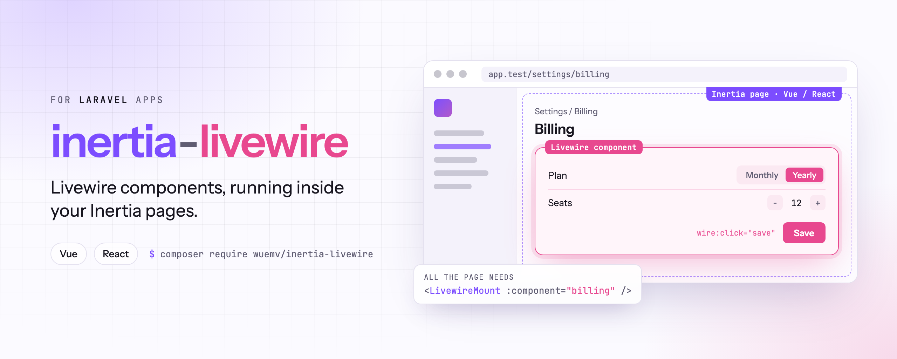

# @wuemv/inertia-livewire

The framework-independent core of the inertia-livewire adapters, for Laravel apps: put a server-rendered Livewire component into an element and start it (`mount`, `start`), stop it (`unmount`), fetch a lazy one (`fetchComponent`), and Livewire events (`on`, `dispatch`).

Use it through an adapter: [`@wuemv/inertia-livewire-vue`](https://www.npmjs.com/package/@wuemv/inertia-livewire-vue) or [`@wuemv/inertia-livewire-react`](https://www.npmjs.com/package/@wuemv/inertia-livewire-react). Details: [github.com/wuemv/inertia-livewire](https://github.com/wuemv/inertia-livewire).
