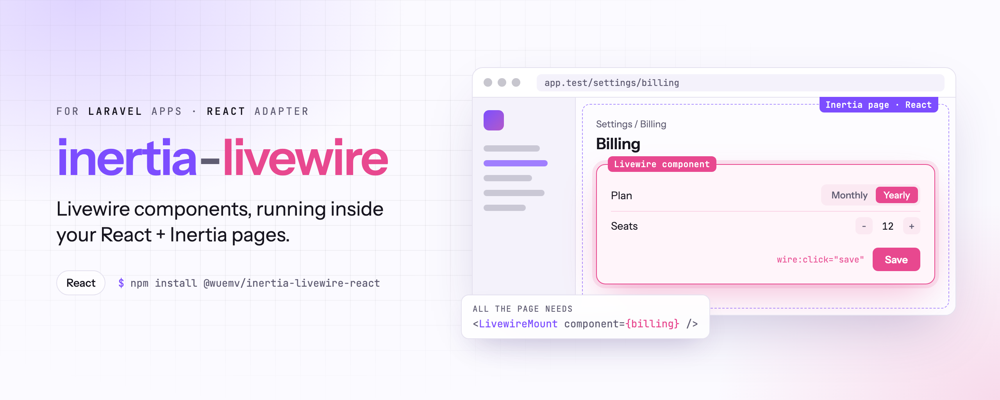

# @wuemv/inertia-livewire-react

Mount Livewire components inside the React + Inertia pages of a Laravel app.

```sh
composer require wuemv/inertia-livewire
npm install @wuemv/inertia-livewire-react
```

```tsx
import { LivewireMount, useLivewireEvent, type LivewireComponent } from '@wuemv/inertia-livewire-react';

export default function Billing({ livewire }: { livewire: LivewireComponent }) {
    useLivewireEvent('saved', (detail) => console.log(detail));

    return <LivewireMount component={livewire} className="p-6" placeholder="Loading…" />;
}
```

Setup, the Laravel side and the details: [github.com/wuemv/inertia-livewire](https://github.com/wuemv/inertia-livewire).
