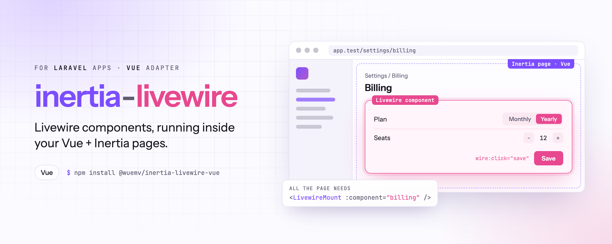

# @wuemv/inertia-livewire-vue

Mount Livewire components inside the Vue + Inertia pages of a Laravel app.

```sh
composer require wuemv/inertia-livewire
npm install @wuemv/inertia-livewire-vue
```

```vue
<script setup lang="ts">
import { LivewireMount, useLivewireEvent, type LivewireComponent } from '@wuemv/inertia-livewire-vue';

defineProps<{ livewire: LivewireComponent }>();
useLivewireEvent('saved', (detail) => console.log(detail));
</script>

<template>
    <LivewireMount :component="livewire" class="p-6">
        <template #placeholder>Loading…</template>
    </LivewireMount>
</template>
```

Setup, the Laravel side and the details: [github.com/wuemv/inertia-livewire](https://github.com/wuemv/inertia-livewire).
